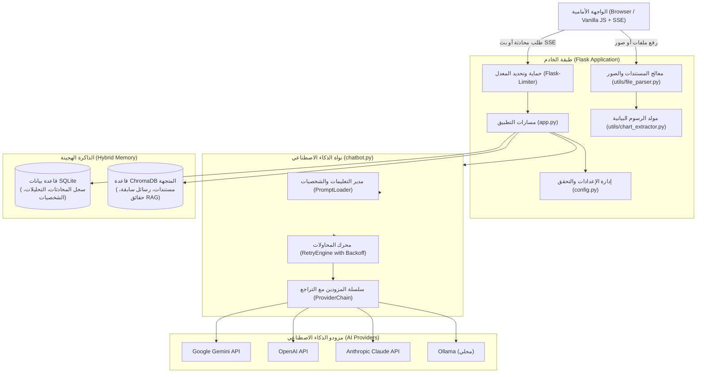

# 🤖 منصة AI ChatBot الذكية المتكاملة (Enterprise AI Ecosystem)

<div align="center">


%20%2B%20ChromaDB-purple?style=for-the-badge&logo=sqlite)


<p align="center">
  <b>منصة محادثة ذكية متطورة مبنية على معمارية Enterprise Orchestration متعددة النماذج، تدعم البث الحي (SSE Streaming)، الذاكرة الهجينة (Hybrid Vector Memory RAG)، معالجة وتحليل الملفات والمخططات البيانية التلقائية، ووضع المقارنة الحية بين النماذج.</b>
</p>

[المميزات](#-المميزات-الرئيسية) • [المعمارية البرمجية](#-المعمارية-البرمجية-system-architecture) • [التثبيت والإعداد](#-دليل-التثبيت-والتشغيل) • [إعدادات البيئة](#-إعدادات-البيئة-env) • [نقاط الاتصال API](#-دليل-واجهات-البرمجة-api-endpoints) • [الأمان](#-الأمان-والحماية)

---

</div>

## 🌟 المميزات الرئيسية

### 1. طبقة أوركستراسيون النماذج (Multi-Provider AI Orchestration)
- **دعم 4 مزودين عالميين ومحليين:**
  - 🟢 **Google Gemini:** الافتراضي (`gemini-2.5-flash`, `gemini-1.5-pro`).
  - ⚪ **OpenAI:** (`gpt-4o-mini`, `gpt-4o`).
  - 🟠 **Anthropic Claude:** (`claude-3-5-sonnet`, `claude-sonnet-4-6`).
  - 🟣 **Ollama:** تشغيل محلي بدون إنترنت وبدون مفاتيح (`llama3`, `mistral`, `qwen`).
- **سلسلة التراجع التلقائي (Fallback Chain):** في حال نفاد الحصة (Quota) أو انقطاع المزود الأساسي، ينتقل النظام تلقائياً وبسلاسة للمزود المتاح التالي دون انقطاع المحادثة.
- **بث متدفق فوري (Token-by-Token Streaming):** استجابة لحظية عبر بروتوكول **SSE (Server-Sent Events)** مع مؤشر كتابة تفاعلي.
- **وضع المقارنة المباشرة (Side-by-Side Compare Mode):** طرح السؤال على نموذجين مختلفين بالتوازي وعرض ردودهما جنباً إلى جنب لتقييم الأداء والسرعة.

### 2. الذاكرة الهجينة الذكية (Hybrid Semantic Memory & RAG)
- **ذاكرة SQLite فورية (WAL Mode):**
  - إدارة الجلسات والمحادثات المتعددة (Threads) مع دعم التثبيت 📌 والتعديل والحذف.
  - استخراج الحقائق الثابتة عن المستخدم تلقائياً في الخلفية (Long-Term Memory Facts).
  - تخزين تقييمات الردود (👍 / 👎) وسجلات الأداء والتحليلات.
- **ذاكرة دلالية عبر قاعدة بيانات متجهة (ChromaDB + Sentence-Transformers):**
  - تجزئة وفهرسة الرسائل والمستندات المرفوعة وحقائق المستخدم تلقائياً.
  - بحث دلالي (Cosine Similarity) لاسترجاع السياق الأكثر صلة بالحديث وحقنه في الاستعلام.

### 3. معالجة المستندات والتصور البياني التلقائي (Multimodal & Auto-Charts)
- **دعم صيغ متعددة:** PDF، DOCX (Word)، TXT، جداول البيانات (XLSX, XLS, CSV)، والصور (PNG, JPG, BMP).
- **تصور بياني تلقائي (Auto Data Visualization):** عند رفع ملفات إكسل أو CSV، يستخرج النظام البيانات الرقمية تلقائياً ويرسم مخططات بيانية تفاعلية عبر **Chart.js**.
- **التعرف الضوئي على الحروف (OCR):** قراءة النصوص من الصور باللغتين العربية والإنجليزية عبر **Tesseract OCR**.
- **أمان وحذف تلقائي:** فحص نوع الملف الحقيقي عبر MIME Magic، وتقييد الحجم، وتوليد أسماء مشفرة، مع حذف الملفات فور الانتهاء من قراءتها.

### 4. واجهة مستخدم فائقة التفاعل (Premium Web UI)
- **تصميم زجاجي عصري (Glassmorphism):** واجهة أنيقة متجاوبة بالكامل مع اتجاه الكتابة من اليمين لليسار (RTL) وخط "Tajawal".
- **مبدل الشخصيات (5 Personas):**
  - 👔 **مساعد رسمي (Assistant):** دقيق وموجز.
  - 🤝 **صديق ودود (Friend):** عفوي وداعم.
  - 💻 **خبير تقني (Tech):** يحلل البرمجيات والنظم بعمق.
  - 📚 **معلم صبور (Teacher):** يبسط المفاهيم بأمثلة واضحة.
  - ✍️ **كاتب إبداعي (Writer):** صياغة أدبية وبلاغية مميزة.
- **أوامر سريعة (Slash Commands):** اكتب `/` للوصول الفوري إلى: `/clear` (مسح المحادثة)، `/export` (تصدير كملف Markdown)، `/summarize` (تلخيص المحادثة).
- **أدوات الرسائل الذكية:** نسخ النص، إعادة التوليد، ترجمة فورية إلى 7 لغات عالمية، استماع صوتي (TTS)، وتعديل الرسالة وتفريغ ما بعدها (Edit & Branch).
- **وضع الصوت المتكامل (Voice Mode):** تحدث بالصوت عبر الميكروفون (STT)، واستمع للردود بنبرة عربية (TTS).
- **لوحة تحليلات متقدمة (Analytics Dashboard):** مراقبة نشاط الرسائل، متوسط زمن الاستجابة (Latency)، توزيع استخدام المزودين، وأكثر الأخطاء تكراراً.

---

## 🏗️ المعمارية البرمجية (System Architecture)



---

## 📁 هيكلية المشروع (Directory Structure)

```text
AI_ChatBot/
│
├── app.py                     # تطبيق Flask الرئيسي ومسارات الـ Endpoints
├── chatbot.py                 # أوركستراسيون الذكاء الاصطناعي وسلسلة التراجع والبث
├── config.py                  # إدارة وتدقيق الإعدادات عبر Pydantic V2
├── requirements.txt           # مكتبات وتباعيات المشروع
├── .env.example               # نموذج المتغيرات البيئية
├── .gitignore                 # حظر الملفات الحساسة وقواعد البيانات من Git
│
├── prompts/
│   └── system_prompt.txt      # تعليمات وهوية النظام الشاملة (System Prompt)
│
├── services/
│   └── memory_service/        # خدمة الذاكرة الدلالية RAG
│       ├── chunking.py        # تقسيم النصوص إلى مقاطع دلالية
│       ├── embeddings.py      # توليد التضمينات عبر Sentence-Transformers
│       ├── vector_store.py    # عمليات قاعدة بيانات ChromaDB
│       └── memory_manager.py  # نقطة التنسيق العليا للذاكرة المتجهة
│
├── utils/
│   ├── db.py                  # عمليات SQLite (المحادثات، الجلسات، التحليلات)
│   ├── file_parser.py         # استخراج النصوص من PDF, Word, Excel, Images
│   ├── chart_extractor.py     # استخراج بيانات الأعمدة الرقمية لـ Chart.js
│   └── helpers.py             # دوال مساعدة لقراءة الملفات بأمان وتعدد الترميزات
│
├── templates/
│   ├── index.html             # صفحة المحادثة الرئيسية
│   └── dashboard.html         # لوحة التحليلات والإحصائيات
│
├── static/
│   ├── style.css              # التنسيقات وتأثيرات Glassmorphism والثيمات
│   └── script.js              # معالجة الواجهة والبث الحي والـ Web APIs
│
└── data/                      # قواعد البيانات والتضمينات المحلية (محمية في .gitignore)
    ├── chat_history.db
    └── chroma_db/
```

---

## 🚀 دليل التثبيت والتشغيل

### المتطلبات الأساسية
- **بايثون:** Python 3.10 أو أحدث.
- **Tesseract OCR (اختياري للصور فقط):** في حال رغبتك بقراءة النصوص من الصور، ثبّت [Tesseract OCR](https://github.com/UB-Mannheim/tesseract/wiki) على جهازك وتأكد من تحديده في PATH.

### 1. استنساخ المستودع وإنشاء البيئة الافتراضية
```bash
# الانتقال لمجلد المشروع
cd AI_ChatBot

# إنشاء بيئة عمل بايثون افتراضية
python -m venv .venv

# تفعيل البيئة (ويندوز PowerShell)
.\.venv\Scripts\Activate.ps1

# تفعيل البيئة (لينكس / ماك)
source .venv/bin/activate
```

### 2. تثبيت الحزم المطلوبة
```bash
pip install -r requirements.txt
```

> [!TIP]
> إذا رغبت بتفعيل ميزة الذاكرة الدلالية (ChromaDB Vector Store) بالكامل، تأكد من تثبيت الحزمتين التاليتين:
> ```bash
> pip install chromadb sentence-transformers
> ```

### 3. إعداد متغيرات البيئة
انسخ ملف الإعداد النموذجي إلى ملف `.env`:
```bash
# على ويندوز
copy .env.example .env

# على لينكس / ماك
cp .env.example .env
```
افتح ملف `.env` وضع مفتاح الـ API الخاص بمزودك المفضل (يكفي مفتاح واحد للبدء، مثل `GEMINI_API_KEY`).

### 4. تشغيل التطبيق
```bash
python app.py
```
افتح المتصفح وتوجه إلى:
👉 **`http://127.0.0.1:5000`** (صفحة المحادثة)  
👉 **`http://127.0.0.1:5000/dashboard`** (لوحة التحليلات)

---

## ⚙️ إعدادات البيئة (.env)

| المتغير | القيمة الافتراضية | الوصف |
| :--- | :--- | :--- |
| `PROVIDER` | `gemini` | المزود الأساسي المفضل (`gemini` / `openai` / `claude` / `ollama`) |
| `MODEL` | `gemini-2.5-flash` | اسم النموذج المخصص (اختياري، يملأ تلقائياً عند تركه فارغاً) |
| `GEMINI_API_KEY` | `""` | مفتاح Google AI Studio API |
| `OPENAI_API_KEY` | `""` | مفتاح منصة OpenAI API |
| `CLAUDE_API_KEY` | `""` | مفتاح منصة Anthropic Claude API |
| `OLLAMA_URL` | `http://127.0.0.1:11434` | رابط خادم Ollama المحلي |
| `TEMPERATURE` | `0.7` | درجة الإبداع في الردود (من 0.0 إلى 2.0) |
| `MAX_TOKENS` | `1000` | الحد الأقصى لطول الرد |
| `SECRET_KEY` | `change-me` | مفتاح تشفير جلسات Flask (يجب تغييره في بيئة الإنتاج) |
| `ENVIRONMENT` | `development` | بيئة التشغيل (`development` أو `production`) |
| `MAX_UPLOAD_MB` | `15` | الحد الأقصى لحجم الملف المرفوع (ميجابايت) |
| `RATE_LIMIT_CHAT`| `20 per minute` | حد الطلبات المسموح به لمسار الدردشة |

---

## 🔌 دليل واجهات البرمجة (API Endpoints)

| المسار | الطريقة | الوصف | Body / المعاملات |
| :--- | :---: | :--- | :--- |
| `/` | `GET` | الواجهة الأمامية الرئيسية | - |
| `/chat/stream` | `POST` | بث الردود حياً عبر بروتوكول SSE | `{"message": "...", "userId": "...", "threadId": "..."}` |
| `/chat` | `POST` | استلام الرد كاملاً بصيغة JSON | `{"message": "...", "userId": "...", "threadId": "..."}` |
| `/upload` | `POST` | رفع مستند أو صورة وتحليلها | `FormData` تتضمن `file`, `userId`, `threadId` |
| `/compare` | `POST` | إرسال السؤال لمزودين بالتوازي للمقارنة | `{"message": "...", "provider1": "...", "provider2": "..."}` |
| `/threads` | `GET` | جلب قائمة محادثات المستخدم | `userId` كمعامل في الـ Query |
| `/threads` | `POST` | إنشاء محادثة جديدة | `{"userId": "...", "title": "..."}` |
| `/threads/<id>` | `PUT` / `DELETE`| تعديل عنوان المحادثة أو تثبيتها أو حذفها | `{"title": "...", "is_pinned": true}` |
| `/translate` | `POST` | ترجمة رسالة محددة إلى لغة مستهدفة | `{"text": "...", "targetLang": "English"}` |
| `/suggestions` | `POST` | توليد 3 أسئلة متابعة ذكية مقترحة | `{"reply": "..."}` |
| `/rate` | `POST` | تسجيل تقييم المستخدم للرد (👍 أو 👎) | `{"messageId": "...", "rating": 1}` |
| `/dashboard` | `GET` | صفحة لوحة التحكم الإحصائية | - |
| `/api/analytics` | `GET` | جلب أرقام وإحصائيات الأداء والمزودين | - |

---

## 🛡️ الأمان والحماية (Security & Hardening)

- **حماية المفاتيح الحساسة:** استخدام كائنات `SecretStr` في [config.py](file:///c:/Users/hp/Desktop/AI_ChatBot/config.py) لمنع طباعة المفاتيح أو تسريبها في السجلات (Logs) أو رسائل الخطأ.
- **فحص الامتدادات والـ MIME:** فحص الترويسة الفعلية الثنائية للملف المرفوع عبر `python-magic` وليس فقط الامتداد الظاهري للاسم لمنع هجمات File Upload Traversal.
- **تحديد معدل الطلبات (Rate Limiting):** دمج `Flask-Limiter` لمنع هجمات الحرمان من الخدمة (DoS) واستنزاف الـ Quota.
- **معالجة XSS:** تنظيف مخرجات الترجمة والرسائل وتوليد عناصر DOM عبر `textContent` وعقد النصوص الآمنة.
- **تأمين ملفات Git:** ملف `.gitignore` محكم يعزل قواعد البيانات والمفاتيح والبيئات الافتراضية تماماً عن المستودع.

---

## 📜 الترخيص (License)
هذا المشروع مرخص تحت رخصة **MIT**. يمكنك استخدامه، وتعديله، وتطويره بحرية.
